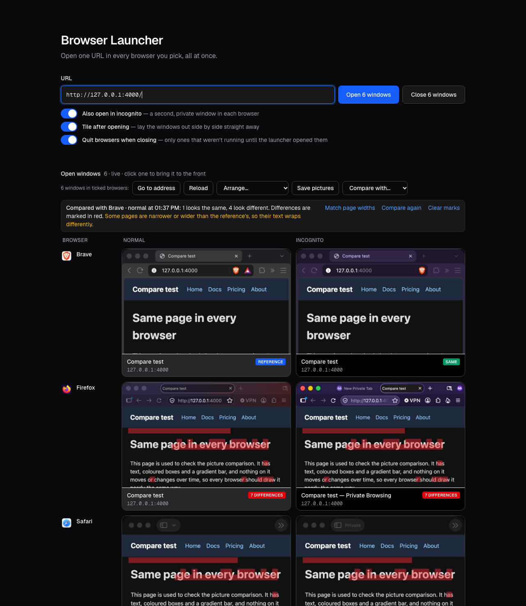

# Browser Launcher

Open one URL in every browser you pick, all at once, and watch and control
all those windows from one page: live pictures of every window, reload or
send them all somewhere else, tile them, compare them, close them. Built with
Next.js, TypeScript, Node.js and Tailwind CSS.



## What you need

- **macOS.** The launcher drives browsers through macOS scripting. Built and
  tested on macOS 26.
- **Node.js 23.6 or newer.** Older versions run the launcher but not
  `npm test`.
- **The browsers you want to use**, installed in `/Applications`. See
  [What each browser can do](#what-each-browser-can-do) for the list it knows.

## Run it

```bash
npm install
npm run dev
```

Then open <http://127.0.0.1:3000>. Or skip the terminal: see
[Start it without a terminal](#start-it-without-a-terminal).

The first time the launcher drives a browser, macOS asks whether it may (see
[Permissions](#permissions-macos-asks-for)). Answer those prompts, or the
launcher waits up to a minute for them.

## Using it

**Open.** Type a URL, tick the browsers, press **Open**. Turn on **Also open
in incognito** to get a second, private window in every browser that can do
it. Turn on **Tile after opening** to have the windows laid out side by side
straight away instead of on top of each other. The URL field remembers the
addresses you used lately.

A browser that wasn't running is started first and then given its window;
Chrome-family browsers started this way skip their welcome, "make me your
default browser" and "restore pages?" prompts. Prompts a page shows itself
(cookie banners, sign-up boxes) and Safari's or Firefox's own prompts can't be
turned off from here.

**Pick browsers quickly.** Under the Browsers heading, *Chrome family*,
*Firefox family* and *Safari family* tick a whole family at once, and
**Save this selection** keeps your own set under a name.

**Open windows.** After you press Open, a list appears: one line per browser,
its normal window on the left and its incognito window on the right. Each box
is a live picture of that window, retaken every couple of seconds, with the
page's title and address underneath (Firefox only gives the title). A window
you close yourself drops off the list. Windows behind other windows are
pictured too, with one catch: Safari and Opera stop drawing a window that is
covered, so its picture goes blank (see [Troubleshooting](#troubleshooting)).

- Click a box to bring that window to the front.
- Hover a box for its own buttons: **enlarge** (a big live view without
  leaving the page), **reload**, **close**.

**Do something to all of them.** The buttons above the list act on the
launcher's windows in the browsers that are ticked at that moment:

| Button | What it does |
| --- | --- |
| Go to address | Sends every window to the address in the URL field. |
| Reload | Reloads every window. |
| Arrange… | Tiles them to fill the screen, or gives them all one width (narrow, tablet, laptop, desktop) to compare layouts. |
| Save pictures | Saves a full-size picture of each window into a new folder under `~/Pictures/Browser Launcher` and shows it in Finder. |
| Compare with… | Pick one window as the reference. Every other window gets a label (**Same** or **N differences**) and the places where its page looks different are marked in red on its picture, also in the enlarged view. |
| Close | Closes them, and only them. Windows you opened yourself are never touched. Untick a browser first to keep its windows. |

With **Quit browsers when closing** on, Close also quits a browser, but only
one that wasn't running until the launcher opened it, and only once it has no
windows left. A browser you already had open is never quit, and neither is
one that brought back windows from last time when it started.

### Comparing pages

The comparison leaves out each browser's own toolbar and sidebar, lines the
pages up, and looks at 16-point squares by colour and amount of detail. So
letters drawn a shade differently don't count, but a box that moved, a
missing image or a line that wraps differently does. Three things make pages
differ that aren't the page's fault:

- **Page width.** A sidebar (Opera) or a window frame makes the page a few
  points narrower, and text then wraps differently. When that happens the
  line above the windows offers **Match page widths**, which resizes the
  windows so every page is exactly as wide as the reference's and compares
  again.
- **Things that change by themselves**: pop-ups, banners, adverts,
  animations. They are marked because they really do look different.
- **Hidden windows.** A Safari or Opera window that is covered by other
  windows isn't drawn, so its picture is blank and everything is marked.
  Keep the windows visible; Tile after opening helps.

The marks belong to the moment of comparing. Go to address, Reload and
Arrange clear them, and **Compare again** retakes them.

## Permissions macOS asks for

The launcher drives your browsers, and macOS guards that. Each permission
belongs to the app that runs the server (Terminal, Cursor, or the Browser
Launcher app below), and you grant it once. **Setup check** at the bottom of
the page shows which ones you have.

| Permission | Where | Needed for |
| --- | --- | --- |
| Control of each browser | macOS asks the first time, once per browser. Later: System Settings → Privacy & Security → Automation | Everything except plainly opening a page |
| Screen Recording | System Settings → Privacy & Security → Screen & System Audio Recording, then quit and reopen the app | Live pictures, saved pictures, comparing |
| Accessibility | System Settings → Privacy & Security → Accessibility | Incognito windows in Safari, Safari Technology Preview and Orion |

Without a permission the launcher still does what it can and tells you what
is missing. The note about Safari and Orion under the browser list goes away
once Accessibility is on (press Rescan if you switched it on with the page
open).

## Start it without a terminal

```bash
npm run make-app
```

builds `dist/Browser Launcher.app`. Double-click it: it builds the project if
the code changed, starts the launcher on its own port (3210, so it never
collides with `npm run dev`) and opens the page. Quit it from the Dock to
stop the launcher. To have it start when you log in, add it under System
Settings → General → Login Items yourself.

The app runs this copy of the project, so run `npm run make-app` again if you
move the folder. macOS asks for the permissions above once more, this time
for "Browser Launcher" instead of your terminal.

## What each browser can do

| Browser | Normal window | Incognito window | Follow, arrange, reload, close |
| --- | --- | --- | --- |
| Chrome, Chrome Canary, Chromium, Brave, Edge, Opera, Opera GX, Vivaldi, Helium | yes | yes | yes |
| Firefox, Firefox Developer Edition, Zen, LibreWolf, Floorp | yes | yes | yes |
| Safari, Safari Technology Preview, Orion | yes | yes, with Accessibility | yes |
| DuckDuckGo, Tor Browser | yes | no | no; close by hand |

Notes:

- **Where the launcher can follow a window, each page gets its own window**,
  not a tab in a window you already had, so that closing it can't take
  anything of yours with it. The browsers in the last row just get the page
  handed to them and put it wherever they like; DuckDuckGo, for one, switches
  to a tab that already shows that address instead of loading it again.
- **LibreWolf is Firefox with strict privacy settings**: it blocks trackers
  and some scripts and hides details about your computer from sites. A page
  that works everywhere else but not in LibreWolf usually depends on one of
  those.
- **Safari, Safari Technology Preview and Orion have no command for a
  private window**, so the launcher presses their own *File → New Private
  Window* for you. That is what needs Accessibility.
- **The Firefox family can't say what a window contains.** The launcher
  recognises its window as the one that appeared right after it asked. If the
  browser isn't running it is started first and given time to bring back
  whatever it wants; only then does the launcher add its own window. If it
  still can't tell which window is its own, it leaves them all alone and says
  so. They also can't be told to reload or go somewhere, so the launcher
  swaps the window for a fresh one in the same place. Their private window
  has an extra blank tab next to the page.
- **Some browsers keep running after Close** even with Quit browsers when
  closing on: those that bring back their last session when they start
  (Opera, Edge, Vivaldi, Brave), and the Firefox family, which keeps a start
  window of its own. Windows the launcher didn't open count as yours, so it
  leaves them, and the browser, alone.

## Troubleshooting

| What you see | Why, and what to do |
| --- | --- |
| A browser takes a minute to open, then can't be closed from the launcher | macOS was waiting for you to allow control of that browser. Find the "… wants to control …" prompt (it can hide behind windows) and click Allow, or turn the browser on under System Settings → Privacy & Security → Automation → (the app running the launcher). Then open it again. |
| A live picture is blank or black | The window is covered by other windows, and Safari and Opera don't draw covered windows. Bring it forward, or tile the windows. Opera keeps drawing if the launcher started it. |
| No pictures at all, only titles | Screen Recording isn't allowed yet. See [Permissions](#permissions-macos-asks-for); macOS needs the app restarted afterwards. |
| Safari opens only a normal window | Accessibility isn't allowed for the app running the launcher. |
| A newly installed browser asks "Are you sure you want to open it?" | macOS does that once for anything downloaded. Click Open; the launcher then carries on. |
| A browser's first-ever start shows a welcome window instead of the page | Some browsers (Floorp, for one) put their welcome page first on their very first start. Close it and open the page again. |
| "Can't reach the launcher server" | The server stopped. Start it again with `npm run dev` (or reopen the app). |

## How it works

A web page can't start or control other apps, so the page asks the Node.js
server, and the server uses macOS scripting.

| File | What it does |
| --- | --- |
| `lib/browsers.ts` | The list of known browsers, finding which are installed, and everything the launcher does with them. |
| `lib/window-control.ts` | The macOS scripting itself: opens each page in a window of its own and hands back a handle for it, and shows, moves, reloads and closes windows by handle. |
| `lib/window-registry.ts` | The server's list of the windows it opened, kept in a small file in the system's temporary folder so it survives reloads. The page only shows that list. |
| `lib/preview.ts` | Takes the pictures. |
| `lib/compare.ts` | Compares two window pictures: finds each page, lines them up and marks what differs. |
| `lib/layout.ts` | Works out where windows go when arranging. |
| `lib/url.ts` | Turns typed text (`example.com`, `localhost:3000`) into a full `http(s)` URL and rejects anything else. |
| `lib/local-request.ts`, `lib/api-request.ts` | Refuse API calls that don't come from the launcher's own page. |
| `app/api/*` | One route per thing the page can ask for: `browsers`, `open`, `windows`, `preview/[key]`, `focus`, `reload`, `navigate`, `arrange`, `snapshots`, `compare`, `match-widths`, `close`, `setup`. |
| `components/` | The page: `launcher.tsx` ties it together; `open-windows.tsx` is the list. |

**Local only.** `npm run dev`, `npm start` and the app make the server listen
on `127.0.0.1` alone. The API also rejects requests from other sites or other
host names, and only ever acts on windows the launcher opened itself. Don't
run it on an address other machines can reach.

## Tests

```bash
npm test             # the logic: URLs, the request guard, layouts, the window list, comparing pictures
npm run test:live    # real browsers; needs the launcher running. Windows pop up.
```

## Add a browser

Add an entry to `CATALOG` in `lib/browsers.ts`:

| Field | What to put |
| --- | --- |
| `id`, `name` | A short id and the name shown on the page. |
| `engine` | `"chromium"`, `"firefox"` or `"webkit"`: which family group it belongs to. |
| `macApps` | The app's name as it appears in `/Applications`, e.g. `["Floorp.app"]`. |
| `scripting` | How it can be driven: `"chromium"` (Chrome's scripting, which most Chrome-based browsers keep), `"firefox"` (Firefox and browsers built on it) or `"safari"` (Safari-style). Leave it out if it can't be scripted; its windows then open but have to be closed by hand. |
| `privateFlag` | The command-line switch for a private window (`--incognito`, `--private-window`). Only add one you have checked: a browser that ignores it would open the page in a normal window while the launcher reports it as private. |
| `linksFollowLastWindow` | `true` only for browsers that put a link into the last-used window even when it's private (Opera does). |

Then press **Rescan** on the page and run `npm run test:live`.
